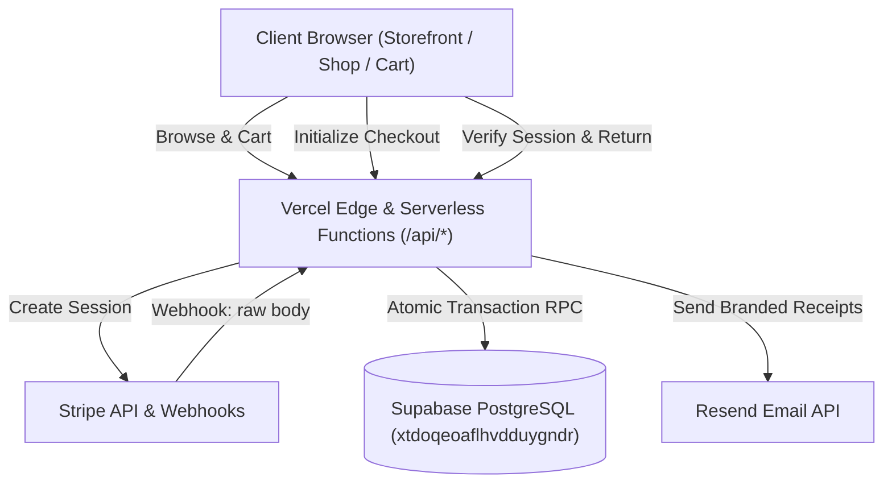

# Off Da Hook Salon Suites — Complete System Audit
**Date**: November 11, 2026  
**Auditor**: Lead Systems & Security Architect  
**Platform**: Off Da Hook Luxury E-Commerce (`https://offdahook.vercel.app/`)  
**Commit**: Latest Hardened Commit on `main`  
**Status**: AUDITED & HARDENED  

---

## 1. System Architecture Overview

Off Da Hook Salon Suites operates as a modern headless JAMstack application deployed on Vercel with a PostgreSQL database hosted on Supabase, payment processing by Stripe, and transactional communications by Resend.

---

## 2. Component-by-Component Baseline Audit

### A. Storefront & Cart Lifecycle
- **Product Catalog (`shop.html`)**: Loads 12 signature crown formulas from authoritative database via `/api/products` (with offline JSON fallback).
- **Cart Management (`main.js`)**: Client-side cart persisted in `localStorage['odh_cart']`. Quantities are constrained to positive integers.
- **Visual Branding**: Premium dark luxury palette (#0F0B15, #FF539B, #1B1526) with video backgrounds and responsive mobile drawers.

### B. Checkout & Payment Pipeline
- **Stripe Checkout (`api/checkout.js`)**: Server-authoritative price calculation, fixed priority shipping ($6.95), US-only address restriction, and item metadata serialization.
- **Webhook Ingestion (`api/webhook.js`)**: Raw stream buffering via `getRawBody(req)` with cryptographic signature verification. Strict checks on `payment_status === 'paid'`, USD currency, and positive amount bounds.
- **Session Verification (`api/verify-session.js`)**: Authoritative session verification directly against Stripe API. Strict session ID format validation. Zero synthetic order ID generation.

### C. Database Architecture (`schema.sql` / `OFF_DA_HOOK_CORRECTED_DATABASE_SCHEMA.sql`)
- **Tables**: `products`, `orders`, `webhook_events`.
- **Atomic Procedure (`process_paid_order_atomic`)**:
  - Two-phase pre-check with row-level locks (`SELECT ... FOR UPDATE`).
  - All items checked for existence, active status, and available stock.
  - Insufficient stock triggers `Backordered_Action_Required` without partial deductions.
  - Successful validation decrements stock and inserts order atomically within the same transaction.
- **Security Hardening**: Search path pinned to `public, pg_temp`. Public execution revoked; `EXECUTE` granted exclusively to `service_role`.

### D. Admin Portal & Order Fulfillment (`admin.html`, `api/orders.js`, `api/auth.js`)
- **Authentication**: HMAC-SHA256 session tokens with 8-hour expiration and constant-time PIN comparison (`crypto.timingSafeEqual`).
- **Order Management**: View real database orders, update fulfillment statuses (`Pending`, `Processing`, `Shipped`, `Delivered`, `Backordered_Action_Required`).
- **Fulfillment**: Manual courier tracking number logging with automatic USPS and UPS tracking link generation.
- **Receipt Resend**: Protected administrative action to re-dispatch email receipts without modifying order items or stock.

### E. Email Infrastructure (`api/webhook.js`, `api/orders.js`)
- Branded customer receipts and merchant alerts via Resend REST API.
- Email delivery tracking in `orders` (`email_status`, `resend_id`, `email_last_error`, `email_sent_at`, `email_attempts`).

