# Off Da Hook Salon Suites — Payment End-to-End Test Report
**Date:** November 12, 2026  
**Scope:** [`api/checkout.js`](file:///Users/macos/Downloads/offdahook/api/checkout.js), [`api/_payment-validation.js`](file:///Users/macos/Downloads/offdahook/api/_payment-validation.js), [`api/webhook.js`](file:///Users/macos/Downloads/offdahook/api/webhook.js), [`api/verify-session.js`](file:///Users/macos/Downloads/offdahook/api/verify-session.js), [`main.js`](file:///Users/macos/Downloads/offdahook/main.js)  

---

## 1. End-to-End Payment Lifecycle Trace

```mermaid
flowchart LR
  A["Cart POST /api/checkout"] --> B["Fetch products (is_active, track_inventory, price)"]
  B --> C["Compute integer cents subtotalCents + 695"]
  C --> D["Insert checkout_intents (Fail-closed HTTP 503 if DB fails)"]
  D --> E["Create Stripe Checkout Session (card only, metadata: checkout_intent_id)"]
  E --> F["Bind stripe_session_id to checkout_intents"]
  F --> G["Stripe Hosted Checkout"]
  G --> H["POST /api/webhook (raw body verify)"]
  H --> I["Fetch checkout_intent & validateStripeSession (amount, currency, status)"]
  I --> J["RPC process_paid_order_atomic (order + stock + outbox)"]
  J --> K["dispatchOrderNotifications (Resend REST + Idempotency-Key)"]
```

---

## 2. Payment Validation & Failure Modes

| Lifecycle Guarantee | Code Implementation | Test Classification |
| :--- | :--- | :---: |
| Integer-cents arithmetic (`subtotalCents`, `shippingCents`, `totalCents`) | Verified in `api/checkout.js` & `api/_payment-validation.js` (`TC-59`, `TC-65`) | **PASS** (Unit / Static) |
| Fail-closed checkout if `checkout_intents` DB insert fails | Returns HTTP 503 before creating Stripe session (`TC-59`) | **PASS** (Static) |
| Checkout intent replay / session mismatch / amount mismatch guards | `INTENT_ALREADY_USED`, `INTENT_SESSION_MISMATCH`, `AMOUNT_MISMATCH` (`TC-50`, `TC-56`, `TC-65`) | **PASS** (Unit / Static) |
| Lazy session binding race defense | `COALESCE(stripe_session_id, v_stripe_session_id)` in SQL (`schema.sql`) | **PASS** (Static) |
| Shared validation parity (`webhook.js` & `verify-session.js`) | Both call `validateStripeSession(session, { intent })` (`TC-19`) | **PASS** (Unit) |
| Storefront confirmation separation | Checks `data.order_persisted && data.order` vs `showPendingOrderConfirmation` (`TC-47`) | **PASS** (Static) |
| **Live Stripe Test-Mode E2E Checkout (Vercel Preview + Test Card `4242...`)** | Awaits Staging Environment & Stripe Test Credentials | **BLOCKED** |
| **Live Async Payment Event Webhook Verification (`async_payment_succeeded`/`failed`)** | Code paths implemented (`TC-24`, `TC-37`); checkout uses `'card'` only | **BLOCKED** (Live E2E) |

